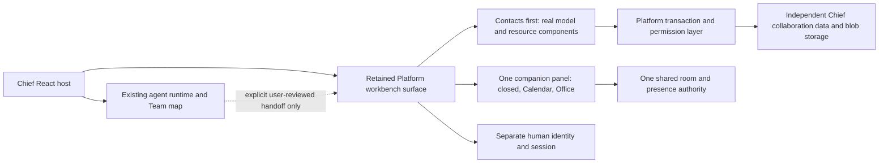

# Retain Platform collaboration behind Chief's existing agent host

Status: **Accepted — owner chose “Retain Platform subsystem (Recommended)” on 2026-10-07. Implementation in progress; no Contacts runtime imported at the time of this decision.**
Date: 2026-10-07.

## Problem and verified context

The owner requests the actual Platform Contacts experience as the first reused
module, alongside an eventual integrated Office, Cards/Spaces/Types, human
Chat/Threads, Tracker, Documents, Inbox, day calendar and Team planner.
Chief must retain its actual OpenMausBot runtime, Routines, agent Team map and
private agent conversations. A generic contact list is not an acceptable substitute.

The owner clarified the intended user is **a single member of an organization**.
Chief combines that member's personal agent workspace with shared project work;
it is not a solopreneur-only product. The two surfaces may run simultaneously
in separate windows/on two screens. They must keep coherent human identity and
organization/project context while keeping personal agent history private.
Shared material crosses into personal agent context only through intentional,
permission-respecting handoffs.

Live Contacts has Employee, Guest, Person and Company views. Person/Company
tables share search, filtering, location, attachments, modification dates,
roles and contact information. The Person create form has first/last name,
location and configurable contact links; Company has a name, rich description,
avatar and contact links. Forms were inspected without creating records.
[Captured form](../verification/evidence/platform-contacts-person-form.jpg).

The view is assembled by the Platform model registry and generic workbench
view system. `contact-resources` declares 28 production dependencies, including
26 Platform packages and Svelte. Its UI is coupled to the transaction client,
identity, view/filter registry, rich editor and attachment services. Copying
one `Contacts.svelte` file would not reproduce the installed experience.

The release-matched baseline is `s0.7.426`, commit
`03b7aad7dc562f4f9769c51a4df08191a0393997`. The reference front image digest is
`sha256:03c16b1ab7ab590f988d781cea345bb2ba06b7f792b819cdb0dd0b39bf14bebe`.
The tag matches the release name; absent OCI revision labels, exact binary
source correspondence remains unproven. Do not mix arbitrary develop models
with release front/server binaries.

## Concrete options

| Choice | Source retained | Consequence |
| --- | --- | --- |
| **A — retained collaboration subsystem (recommended)** | Pinned Svelte workbench, Contacts model/resource/server modules and supporting Platform services; Chief React host remains the agent application | Most faithful route to the requested multi-module experience. Requires a second application runtime and human-account/workspace boundary. The current reference stack has 15 containers; the selected minimal service closure still needs measurement. A source-mounted module is not a standalone widget. |
| B — faithful source port onto Chief services | Retain/adapt Contacts UI and behavior, replace Platform transaction/query/model/identity/view integrations with Chief equivalents | Avoids a permanent full Platform service layer, but requires substantial source adaptation across the shared UI/data system. It must reproduce filters, role behavior, files, editing and identity semantics; later Cards/Chat/Documents compound the work. No claim of a quick drop-in port. |

Copying a simplified contact list or displaying a screenshot is rejected.
Pointing a production Chief tab at the owner's existing CES workspace is also
not the independent integration: that would couple writes and identity to
reference data without a migration decision.

## Reviewable boundary for option A

This diagram is proposed architecture, not running code. A retained surface
may be a separately served workbench inside the Chief host; iframe versus
Svelte mounting is an engineering sub-choice to test, including CSP, session,
history and device permission behavior. Do not weaken framing or session
protections just to make an embed render. A plain iframe of the live reference
stack is not completion.

1. Pin a separate source/build area and retain EPL-2.0 license/copyright
   notices and a modified-file inventory. Build compatible model, frontend
   and server artifacts from the same release commit.
2. Establish an independent synthetic collaboration environment for the
   Contacts slice. No owner contact data, tokens, database volumes or secrets
   are copied. Existing reference Platform stays usable and unchanged.
3. Retain the source-defined Contacts views/forms, table/filter registry,
   identity, attachments and rich description editing. Initially expose
   selected Contacts navigation; do not confuse hidden navigation with
   removed dependencies or server authorization.
4. Define explicit Chief-person to Platform-person/account mapping. A contact
   record is not automatically a signed-in user or office member. Employee/
   Guest access changes require server enforcement and separate test accounts.
5. Keep human collaboration credentials outside agent model context. Do not
   forward Chief owner capabilities, provider OAuth material or private agent
   history into the retained surface. Any navigation bridge must validate
   origin and route identifiers; it must not accept arbitrary commands/tokens.
6. Add lifecycle/error handling, compatible asset/route loading and a clear
   unavailable state. Keep Team map and Routines functional independently.

## Shell and Office behavior that constrains the integration

Main navigation and the companion panel are independent. The right panel has
three states: closed, day calendar/planner, or compact Office. It must keep
working alongside a Card, Contact, Inbox, document or issue. Calendar shows an
advancing current-time line and opens event creation when an eligible time is
clicked. Team planner remains selected despite overlap with Chief Routines.

Compact and full Office must share people, presence, rooms and meeting state.
The owner clarified that retained Platform Office **replaces the earlier custom
Chief Shared Office**. Preserve the original agent Team map and its data; its
Office entry and the Shared Office navigation will converge on the validated
retained Office. Keep the existing entry working until replacement acceptance
passes. Do not migrate or delete the earlier Office data implicitly.
The owner must remain on a Card while bringing people into a discussion.
Do not independently create a second room store or duplicate meetings in the
sidebar. Choose and test one room authority before connecting either UI; an
adapter must preserve Chief's explicit acceptance and media permission rules.

Dragging another person's face/contact tile into a room requests an invitation;
it must not silently join or capture their devices. Dragging self uses normal
authorized join. Provide equivalent click and keyboard actions and truthful
pending/accepted/declined/expired/joined/left states. This is a requested Chief
enhancement, not a verified claim about existing Platform drag-and-drop.

## Contacts acceptance before completion

- Run with empty synthetic data, create person/company, edit and reload them.
- Verify search, actual table/filter controls, contact links, rich description,
  attachments, avatar behavior and cancellation without phantom records.
- Verify Employee/Guest identity flows separately from ordinary contacts; a
  synthetic outsider cannot read or modify restricted records/attachments.
- Leave Contacts open while switching the companion panel; main work survives.
- Restart retained services and verify persisted records plus session recovery.
- Existing agent Team map, provider setup, Routines and private chats still work.
- Open personal-agent and shared-collaboration surfaces simultaneously on two
  screens. Synchronize identity/workspace context and shared room/presence state
  without leaking private history or starting a second microphone capture.
- Verify desktop and narrow layouts, keyboard operation and unavailable states.

## Accepted decision

The owner chose **A: retain Platform's collaboration engine and source UI within
Chief**, in response to the concrete options above. Continue implementation on
that basis without asking again. The source port remains the rejected alternative.

The owner explicitly accepts a separate collaboration login. The current host
therefore does not promise unified sign-in or forward personal agent credentials.
Meetings are the highest-priority Office workflow for the first usable release.

On 2026-10-07 the independent `chief-platform` deployment passed its startup
guards and served the real workbench at `http://localhost:18087`. The Chief host
at `http://127.0.0.1:5299/workspace` displays its separate sign-in. Real Contacts
acceptance uses only the synthetic Chief Acceptance organization; evidence is
in `docs/verification/evidence/chief-platform-contacts.json`. Media and Office
admission changes remain in progress and are not implied by service readiness.

Current resource evidence matters: the reference stack runs 15 containers,
and the host previously had approximately 0.8 GiB free RAM. Do not start a
second whole stack blindly. After the architecture choice, measure the required
service closure and run only a bounded disposable environment; address a real
capacity conflict explicitly rather than shutting down unrelated owner work.
