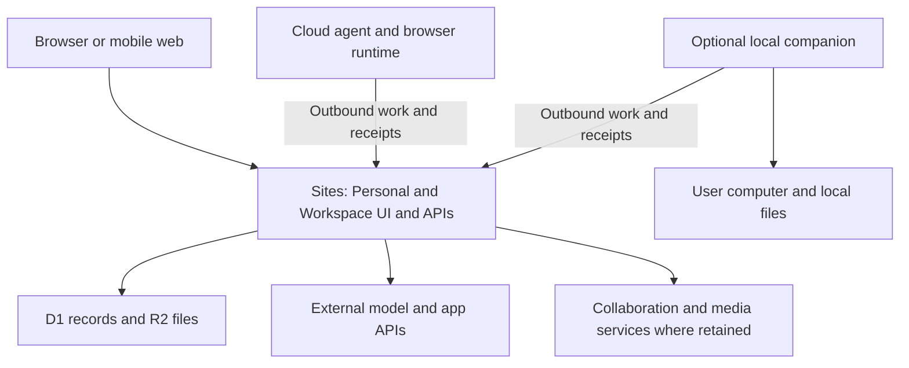

# Chief Personal and Workspace: Sites hosting audit

Date: November 4, 2026, America/Los_Angeles. Status: source and platform-contract audit; no migration or deployment performed.

Supporting evidence: [81 source anchors, hashes and dependency inventory](<C:/Users/amank/Documents/ChatGPT/CHIEF SOFTWARE WORKSPACE/chief-executive-suite/docs/audits/evidence/chief-sites-hosting-2026-11-04.json>).

## Decision

Both products' browser interfaces, ordinary application APIs, structured records and uploaded files are candidates for a Sites-native rewrite. The current full products cannot run exclusively inside the documented Sites environment with equivalent functionality.

The hard boundary is agent execution and native services, rather than database hosting. Codex, Claude, ACP/Pi agents, the Hermes Python runtime, browser automation, desktop control, local models and the current meeting transcription worker need an execution environment outside Sites. That environment can be a customer's computer or a cloud runtime. Access to the customer's actual desktop, installed applications, USB devices or unsynchronized files requires a component on that computer.

Two additional boundaries are unresolved: production-grade real-time collaboration and durable autonomous scheduling. Cloudflare has products for these purposes, but the installed Sites contract does not establish that their bindings and handlers are available through Sites. They are not classified as impossible; they are classified as unverified and require a fallback or a hosted proof before commitment.

External model, speech, media and app providers can eliminate a Chief-managed server for some features. Calling a service from Sites does not mean the service's execution runs within Sites.

## Scope and confidence

Primary checkout: `C:/Users/amank/Documents/ChatGPT/CHIEF SOFTWARE WORKSPACE/chief-executive-suite`, branch `codex/chief-unified-platform`, HEAD `fc5003a7807c83d737f3b4e28ed85f15ae8b3167` (November 3). The audit includes current uncommitted source and the November 4 installer report. This is important because older handoffs describe pairing as read-only, whereas current source also implements narrow Tracker writes and automatic member profile provisioning.

Personal means the React browser client, Node harness, provider drivers, Electron integration and optional phone companion. Workspace means the retained collaboration application, its Chief patches, SQL lifecycle bridge and optional meetings/capture services. The separate Personal Office implementation is also covered; it is not treated as identical to retained Workspace meetings.

The retained source at `.chief-local/platform-source` was inspected only as source code, including the model registry, Transactor startup and Hocuspocus collaborator. No owner configuration, database, account token or conversation was opened. Other release/selective worktrees and compiled installers were identified but not independently audited. This report does not attest the exact binaries currently running on any machine.

Evidence levels:

- **Sites rewrite:** documented primitives support the proposed application pattern. Portability is an architectural assessment, not a deployed acceptance result.
- **External service:** Sites can own the UI/API caller; execution or storage still occurs in an explicitly connected external service.
- **Local companion:** required for the user's actual machine or native OS features.
- **Local or cloud runtime:** existing executable/service cannot run in the documented Sites runtime; a separate environment is required to retain it.
- **Unverified:** required Sites capability or production behavior is not documented or has not been exercised. Do not sell it as supported or label it permanently impossible.

## Sites contract used

The installed OpenAI Sites skill is version 1.1.3. Its documented production surface includes static assets, Worker server code, D1 records, R2 objects, Sites authentication, runtime secrets, eligible visitor-scoped app integrations, Site-hosted MCP tools and linked cloud-task updates. Its server runtime has 128 MB per isolate and HTTP-based external connections; its contract says raw TCP is unavailable.

Sources: [Sites skill](C:/Users/amank/.codex/plugins/cache/openai-curated-remote/sites/1.1.3/skills/sites/SKILL.md), [storage](C:/Users/amank/.codex/plugins/cache/openai-curated-remote/sites/1.1.3/skills/sites/references/storage.md), [identity and secrets](C:/Users/amank/.codex/plugins/cache/openai-curated-remote/sites/1.1.3/skills/sites/references/identity-and-secrets.md), [app integrations](C:/Users/amank/.codex/plugins/cache/openai-curated-remote/sites/1.1.3/skills/sites/references/app-integrations.md), [MCP server](C:/Users/amank/.codex/plugins/cache/openai-curated-remote/sites/1.1.3/skills/sites/references/site-mcp-server.md), [recurring updates](C:/Users/amank/.codex/plugins/cache/openai-curated-remote/sites/1.1.3/skills/sites/references/recurring-updates.md).

Important limits on interpretation:

1. The supplied hosting manifest/starter documents D1 and R2 bindings. Durable Objects, Queues, Workflows, Vectorize, Browser Rendering, Containers, custom cron handlers, email bindings and arbitrary service bindings are not established Sites capabilities by the inspected contract. Absence of documentation is not proof of permanent prohibition.
2. Sites sign-in supplies identity, not workspace membership, a model subscription or connected-app consent. User IDs differ across Sites. One Site with separately authorized Personal and Workspace areas avoids assuming identities automatically match across two Sites.
3. Native connector writes require an explicit signed-in visitor action and write consent. Request-scoped connector bindings cannot be saved and reused by an unattended agent. Scheduled work needs its own supported authorization path. The required native plugin-eligibility discovery tool was not available in this session, so no particular Chief app connection is attested as Sites-eligible.
4. Linked cloud tasks can call a writer while a page is closed. That does not establish a built-in always-running scheduler, exact firing guarantees, arbitrary execution duration or unattended access to a visitor's app connections.
5. Cloudflare Workers generally support request streaming. There is no blanket 30-second HTTP streaming limit while a client stays connected. After a response/disconnect, `waitUntil()` only extends work for up to 30 seconds; it is not durable background execution. See [Worker limits](https://developers.cloudflare.com/workers/platform/limits/).
6. `node:child_process`, `node:sqlite` and `node:worker_threads` are nonfunctional stubs in the current general Workers compatibility table. An import/build succeeding cannot prove Chief's runtime works. See [Node compatibility](https://developers.cloudflare.com/workers/runtime-apis/nodejs/#non-functional-stub-modules).
7. D1 supports FTS5, so simple message/text search need not retain Elasticsearch. Database limits and query concurrency still matter; standard Cloudflare plan limits do not establish the user's Sites allowance. See [D1 SQL](https://developers.cloudflare.com/d1/sql-api/sql-statements/) and [D1 limits](https://developers.cloudflare.com/d1/platform/limits/).

## Chief Personal feature map

Every Sites rewrite below includes replacement of filesystem persistence, process-global state and loopback-owner trust where applicable. These are not unchanged deployments.

| Feature | Placement | What must change / what remains outside |
| --- | --- | --- |
| Chat screens, team map, agent profiles, settings, instructions, themes, approval/question cards | Sites rewrite | Retain browser components; replace Node/Electron calls with authenticated same-origin APIs. Native window/tray controls remain optional companion features. |
| Bots, teams, sections, presets, selected Agency catalog and profile versions | Sites rewrite | JSON files/in-memory store become tenant/member-scoped D1 records. Profiles are portable instructions, not executable agents. Owner credentials are not catalog content. |
| Messages, threads, follow-ups, command receipts and task-result metadata | Sites rewrite | Replace `node:sqlite`, local transactions and worker-thread search. Preserve identifiers, ordering, retention, result provenance and idempotency. |
| Conversation and memory text search | Sites rewrite, feature/scale testing required | D1 FTS5 is a plausible replacement for current SQLite FTS5; port tokenization, queries and authorization, then test migrations and retrieval quality. |
| Personal/team memory, learned profiles, skills text and playbooks | Sites rewrite for content | Move Markdown/files to D1/R2. Any skill executing Python, a shell, browser or native binary still needs a runtime. Owner Hindsight remains a separately authorized service, never a customer default. |
| Attachments, audio notes, generated images and saved artifact files | Sites rewrite for storage/delivery | R2 holds objects; D1 holds ownership and versions. Replace local paths with object IDs and authorize every delivery. Generation/transcription compute is separate. |
| API-key text/multimodal conversations through OpenAI-compatible, Grok, Mistral, Cerebras or MiniMax APIs | Sites rewrite plus external model provider | Adapt HTTP/SSE model calls and tool execution. Current API drivers still mount local MCP subprocesses and retain live runs in memory, so they are not deployable unchanged. MiniMax's local credential discovery must be replaced. |
| Existing Codex and Claude agents, including their current tools and login flows | Local or cloud runtime | Drivers spawn installed CLIs and use provider homes, working directories and local IPC. Replacing them with HTTP model calls is a different runtime and requires explicit feature/auth/billing evaluation. |
| ChatGPT-plan route | Runtime plus provider approval constraint | Current Codex source explicitly rejects hosted plan sign-in pending hosted-app approval, and still launches Codex app-server after obtaining credentials. Sites sign-in does not grant model-plan usage. Hosted entitlement must be independently approved and tested; API-key mode is a separate choice. |
| ACP agents: Grok, Gemini, Kimi, Droid, Cursor, OpenCode, Qwen, custom ACP; Pi; Antigravity | Local or cloud runtime | Existing paths launch agent executables. Sites can dispatch to their remote runtime; it cannot launch them itself. |
| Hermes agent | Local or cloud runtime | The Chief driver speaks HTTP/SSE, but calls a separate Hermes API service. Its managed tool bridge, command review and physical-request budget enforcement depend on native/Python execution and local bridge state. |
| BoatAgent/remote cloud computer-backed agent | External execution service | The HTTP client is portable in principle; the remote provider/computer remains outside Sites. Validate that service's supported authentication and availability. |
| Delegation, inter-agent messaging, run cards, approvals, decisions, usage and budget records | Sites rewrite for APIs/state; execution conditional | Move capability checks, queues, spend/request reservations and journals to transactional persistent state. Never share `Map`/`Set` state between tenants or assume it survives isolates. Agent execution inherits the selected runtime's placement. |
| Active chat token streaming | Unverified hosted transport; feasible Worker pattern | Port Node response handling to Web Streams, persist cursors and recover after disconnect/deploy. Sites proxy buffering, timeouts and reconnect behavior require a hosted test. Polling persisted progress is a fallback, not identical live delivery. |
| Unattended routines, proactive work and resumable human approvals | Unverified for complete Sites-native execution | Current 10-second timer, file ledger and persistent Hermes process must be redesigned. A linked cloud task can trigger bounded work with supported authority; it is not evidence of exactly-once execution or a durable workflow engine. Keep an external runner until cancellation, leases, budgets, recovery and missed firings are proven. |
| Webhook intake and trigger records | Sites rewrite for receiver/storage | HTTP verification and durable deduplication can live in Sites. The resulting task must be durably handed off; don't rely on a detached request promise. |
| Remote HTTP MCP client and Jev calls | Sites rewrite plus external service | HTTP adapters can be ported. Remove subprocess proxy indirection; retain caller/tool scopes and bounded responses. A private/loopback-only endpoint needs an outbound bridge or an independently reachable service. Legacy persistent SSE sessions require transport testing. |
| Native Sites app connections | External connected apps, eligibility/consent unverified | Use discovered eligible apps and server-owned actions. Current Composio/Chief connections are not automatically Sites connections. Unattended writes cannot reuse visitor-bound consent/bindings. |
| Chief's own MCP connector for ChatGPT/Codex | Sites rewrite, documented capability | Implement authorized tools at the Site's stateless `/mcp`; publishing creates its private plugin. This exposes tools, not the entire UI protocol, CLI execution or an unattended scheduler. Tool acceptance and install/connect still need testing. |
| Terminal, Git checkout, package installation, builds, code/test execution, local model inference | Local or cloud runtime | Native processes and a real working filesystem are required for existing implementations. Lightweight explicitly ported JS/WASM functions are different, bounded features. |
| Browser automation, browser profiles, watch/takeover and computer-use tools | Local or cloud runtime | Current browser runtime spawns an engine. A separate browser service may replace it, with credentials/session/takeover parity tested. Browser Rendering availability through Sites is unverified. |
| User's desktop, native apps, arbitrary local folders, screen capture/input, USB/Android ADB | Local companion | A remote cloud machine cannot substitute for the user's physical machine or unsynchronized files. Browser-selected upload/download or screen sharing can cover narrower explicit interactions. |
| Local VM/Docker, VPS desktops, SSH tunnels and fleet workloads | Local or cloud runtime | Sites can present/manage authorized status through an API; it cannot run the current Docker/SSH/VM commands inside its Worker. |
| Cloud speech/image generation and TTS | Sites API caller plus external provider | HTTP speech providers are portable callers. Store output in R2; validate streaming and limits. Local Chatterbox/model servers remain external; macOS `say` needs the Mac companion. |
| Agent voice calls | Split; full hosted transport unverified | SDP/token setup is a plausible Sites API. Browser/provider carries audio; the existing sideband and Gemini bridges retain sockets/session state and invoke the chosen agent runtime. Hosting the token endpoint alone does not preserve full calling behavior. |
| Personal Office room membership, invitations, notes | Sites rewrite | Current office JSON state becomes authorized D1 data. This smaller Office implementation does not migrate retained Workspace collaboration automatically. |
| Personal Office human audio/video calls | External media service | Sites can authorize rooms and mint tokens; current LiveKit server carries media. Browser microphone/camera remains client-side with explicit permission. |
| Phone access and pairing | Sites rewrite for web client / pairing records; companion when executing locally | A hosted browser UI can work without the old phone relay for API-only features. Existing iOS/Android clients need protocol/auth migration. The current phone sidecar rejects browser Origin requests and is not a ready-made Sites browser bridge. |
| Backups, import/export and restore | Sites rewrite for cloud records/files; runtime for existing archives | Rebuild around D1/R2 export/restore and consistency checks. Current tar/encryption/SQLite snapshot/worker-thread filesystem path is not portable unchanged. Restoring local working folders/provider homes still needs the companion. |
| Desktop notifications, global shortcuts, startup, sleep/wake, keychain, updater, installers | Local companion | Browser equivalents can cover selected notifications/downloads with different permissions and lifecycle. Native OS behavior remains outside Sites. |

Personal evidence: `src/components/DesktopCapabilities.tsx`; `server/store.ts`; `server/message-db.ts`; `server/message-search-worker.ts`; `server/memory-store.ts`; `server/skills.ts`; `server/attachments.ts`; `server/task-results.ts`; `server/drivers/builtIn.ts`; `server/drivers/openai-chat.ts:180,498`; `server/drivers/chat-mcp-tools.ts:259`; `server/drivers/codex.ts:615,841`; `server/drivers/claude.ts`; `server/drivers/acp/core.ts`; `server/drivers/pi.ts`; `server/drivers/hermes-http.ts`; `server/drivers/hermes-http-client.ts`; `server/browser-runtime.ts:68`; `server/routines.ts:1503`; `server/background-work.ts`; `server/live-call-controller.ts`; `server/gemini-live.ts`; `server/office.ts`; `server/office-media.ts`; `server/tts/`; `server/chief-pairing-storage.ts`; `server/workspace-backup.ts`; `companion/README.md`; `electron/`; `installer/BUILD-REPORT.md`. Exact paths/hashes and representative anchors are in the companion evidence file.

## Chief Workspace feature map

Retained model source includes Tracker, board, calendar/planner, documents, Drive, contacts, chat, lead/CRM, recruiting, time, controlled documents, training and test-management modules. Presence in the registry does not prove each module is enabled, configured or accepted in the current customer product. The classification below addresses these capabilities where retained; it does not claim new integrations already exist.

| Feature | Placement | What must change / what remains outside |
| --- | --- | --- |
| Navigation, project/task boards, dashboards, contacts, calendar/planner screens | Sites rewrite | Reuse suitable UI patterns/assets; port data calls. Retained UI is built around Platform classes, query/transaction APIs and plugins, so changing a database URL is insufficient. |
| Projects, issues, statuses, comments, contacts, events, notes and ordinary business records | Sites rewrite | Define D1 schemas and migration adapters. Preserve workspace IDs, object relationships, permissions and histories. Full equivalence of each retained plugin requires explicit acceptance. |
| Documents and files without simultaneous editing | Sites rewrite | R2 blobs plus D1 metadata/content/version pointers can support versioned save with conflict detection. Rich editor features and existing document encodings require converters/tests. |
| Collaborative rich-text editing, awareness, live presence and multi-client transaction broadcasts | Unverified Sites-native; existing implementation needs cloud/local services | Current collaborator runs Hocuspocus/WebSocket sessions and storage extensions; Transactor uses a persistent pipeline/queue. Cloudflare Durable Objects is a candidate only if Sites exposes it. Ordinary polling or revision conflicts is a narrower product, not parity. |
| Workspace/member/role/space/document access, guest links and revocation | Sites rewrite with substantial authorization migration | Sites identity must be bound to Chief membership explicitly. Reimplement Accounts membership epochs and record/space ACLs; authorize parent objects before file delivery. Existing passwords/provider sessions/guest flows are not automatically replaced by ChatGPT sign-in. |
| Member-to-personal-agent connection and scoped Tracker reads/writes | Sites rewrite for bridge/control records; external runtime if retained agents used | Current Tracker adapter reads/creates/updates narrow issue fields through member-scoped Transactor/Collaborator calls. Preserve confirmations, request IDs, ambiguous-write handling and membership rechecks. It is not a generic full-workspace API. |
| Automatic per-member agent profiles and renewable membership leases | Sites rewrite for records; existing provisioning bridge needs redesign | Current private filesystem mailbox and 60-second leases coordinate a local personal host. Replace the mailbox with an authenticated persistent protocol. Portability does not establish hosted tenant isolation. |
| Planner/calendar awareness of Personal routines | Sites rewrite for shared definitions/read models | Current roadmap requirement is broader than established production integration. Synchronization rules, private visibility and execution ownership need definition/acceptance. Running a linked routine follows the scheduling/runtime constraints above. |
| Stored chat, inbox, activity, notifications and comments | Sites rewrite | D1 can hold records and access rules. Live broadcasts, email/push delivery and provider channels require their own supported transports/integrations. |
| Basic search over extracted text | Sites rewrite, semantics/scale testing required | D1 FTS5 can support bounded indexed text. Existing Elasticsearch ranking, filtering and indexing behavior must be explicitly mapped; it is not a compatible Elasticsearch endpoint. |
| Office/PDF attachment extraction, rich previews, conversion and server PDF printing | Local/cloud service or managed API for current behavior | Rekoni/print are service containers. Browser printing can replace a narrower interactive export. The current conversion/extraction services are not Worker code. |
| Human meeting room records, consent, invitations, minutes, recording metadata | Sites rewrite | Migrate authoritative consent state, session checks, review history and authorized artifact pointers. Media acquisition/processing is distinct. |
| Meeting audio/video/screen-sharing transport | External media service | Existing LiveKit uses TCP/UDP ports. Use LiveKit or another separately verified service; Sites handles authorization/UI rather than operating the media server. |
| Meeting recording subscriber and offline transcription | Local or cloud runtime, or different managed transcription service | Current Python/faster-whisper worker joins authorized rooms, captures audio and performs local inference. A cloud/API substitution changes processing location and must preserve consent/revocation/review semantics. It is not the same local-only privacy behavior. |
| Reviewed transcript import, summaries, action-item drafts | Sites rewrite for records and bounded API calls | Model-backed summaries use an external provider. Preserve unsent draft/review behavior; multi-step autonomous dispatch still needs durable execution. |
| Gmail/calendar/Slack/other app synchronization and unattended notifications | External services; authority/scheduling unverified | App connectors, OAuth refresh, webhooks, backfill and background delivery need supported per-account access. Sites sign-in/one visitor's connection grants no workspace-wide or unattended authority. |
| Retained advanced plugins and server lifecycle migrations | Existing stack requires local/cloud server; individual replacements possible | Training, controlled documents, recruiting, test management, inventory/CRM and other plugins contain more than CRUD screens. Audit their workflows individually before claiming complete replacement. |
| Workspace administration, analytics, quotas, billing/entitlement records | Sites rewrite for app records | Map roles and policies; payment/billing authority is external if used. Sites hosting does not supply Chief's undecided commercial permission matrix. |

Workspace evidence: `integrations/platform/compose.json`; `integrations/platform/meetings.compose.json`; `.chief-local/platform-source/models/all/src/index.ts`; `.chief-local/platform-source/server/collaborator/src/server.ts:60,209`; `.chief-local/platform-source/pods/server/src/__start.ts`; `docs/architecture/chief-stage0-contracts.md`; `integrations/platform/lifecycle/{main,http,tracker,provisioning,pairing,member}.mjs`; `integrations/platform/lifecycle/001-pairing.sql`; `integrations/platform/lifecycle/003-tracker-actions.sql`; `server/huly-tools.ts`; `server/customer-members.ts`; `integrations/meeting-capture/README.md`.

## Existing service disposition

Source manifests define 15 base services, two additional meeting services, and one optional lifecycle service. This is a manifest count, not a live container inventory.

| Current service | Sites-native replacement or required placement |
| --- | --- |
| nginx | Sites routing/static serving can replace its application-edge role after route/auth migration. |
| front | Browser assets can be hosted; server handlers and deployment configuration must be ported. |
| cockroach | D1 can replace selected application records after schema/query/transaction redesign. Existing PostgreSQL/Cockroach wire clients and SQL migrations do not become D1 compatible. |
| minio / Silo | R2 can replace object storage after API/key/link/metadata migration; it does not expose a local filesystem. |
| redpanda | No established native Sites queue replacement. D1 outbox plus an independently verified runner is an option; durable consumer, leases and retry semantics must be implemented. |
| elastic + fulltext | Basic text search can be redesigned for D1 FTS5. Preserve external service if required search/extraction parity cannot be reproduced. |
| transactor | Rewrite domain transactions, authorization, broadcasts and model machinery, or retain externally. It is not a transparent D1 adapter change. |
| collaborator | Retain externally until a Sites-supported durable real-time replacement passes multiuser acceptance. |
| account | Replace sign-in with Sites identity only after explicit membership/identity mapping; preserve roles, epochs and revocation in Chief APIs. Existing independent login compatibility is unverified. |
| workspace | Replace provisioning/migrations/index-job lifecycle with supported bounded operations and a durable scheduler, or retain externally. |
| kvs | D1 can replace simple key/value application state; current protocol clients need adapters. |
| stats | Port bounded metrics/usage records, or use a separate telemetry service. Existing service is not inherited automatically. |
| rekoni | Separate document processing service/API for existing extraction/conversion. |
| print | Separate browser/print service for equivalent server rendering; browser Print covers a narrower use case. |
| love | Room/admission/consent APIs are rewrite candidates; its current long-lived coordination/media integration needs redesign or external hosting. |
| livekit | External media server/service. |
| chief-lifecycle overlay | Pairing/authorization/Tracker control logic can be ported, but PostgreSQL transactions, secrets, membership checks, mailbox provisioning and renewal timers must be replaced. |

Two existing Chief components already use general Cloudflare Workers/D1: the control plane and Composio broker. They are useful porting references, not proof of Sites compatibility. The control plane also declares email and cron bindings, has its own authentication and manages external Cloudflare tunnels. Sites support and Chief-owned provider infrastructure must be verified independently; inherited upstream account IDs/domains are not a Chief deployment entitlement.

## Recommended architecture

Use one Sites application with Personal and Workspace sections, a shared identity boundary, explicitly separate personal and workspace data access, D1 application records and R2 artifacts. Persist run/approval/event/idempotency state rather than relying on Worker memory. Keep provider credentials server-side with a reviewed per-user credential design; a Site-wide secret is not automatically a multi-user credential vault.

For the current full feature set, add a separately hosted execution service for CLI agents, Hermes, browser sandboxes and compute-heavy jobs. Keep the retained collaboration services until their replacements are accepted. Use external media/document-processing services where needed. A managed provider may cover one of these roles without a Chief-managed VM; that still belongs in the dependency inventory.

Make the desktop companion optional for API-only use and mandatory when the person selects access to their actual computer. Prefer an outbound authenticated work/receipt channel; polling can avoid an inbound tunnel. WSS is optional only after Sites transport verification. Browser code must not directly receive runtime credentials or assume it can call localhost. The existing native-phone sidecar intentionally rejects browser requests, so it needs a new supported bridge rather than a CORS relaxation.

The cloud runtime and retained services are external dependencies for current capabilities. Their roles can shrink only after replacements pass the gates below. The diagram does not imply those connections already exist in a deployed Site.

The companion should retain native execution, provider homes/logins, local file scopes, OS permissions and lifecycle controls. Sites should send narrowly scoped work envelopes and receive progress/artifact receipts. Persist exact member/workspace/runtime bindings, revocation generation, request IDs and input versions. Do not duplicate canonical editable workspace records during transition.

This architecture allows a person to read/write cloud records, use approved API-only agents and access shared work while their computer is off. Work requiring their computer waits for that companion. Cloud-runtime jobs can continue only if their execution host and authority remain available. Durable execution and real-time parity are acceptance gates, not assumptions.

## Required proof before promising a migration

| Gate | Concrete acceptance evidence |
| --- | --- |
| Sites account/platform limits | Confirm effective CPU, request/upload, D1/R2, database-binding, audience and external-user limits for the selected account. Public Cloudflare plan limits are not a Sites allocation. |
| Identity and tenancy | Two synthetic users/workspaces: private agent/messages/files never cross; role removal/rejoin invalidates old authority; guest access remains scoped. Test account switching and multi-tab behavior. |
| Basic API agent | Deployed API-backed conversation with token streaming, tools, usage and persisted final result; retry/reconnect does not duplicate effects. |
| Streaming | Verify hosted SSE/WebSocket upgrade, proxy buffering, reconnect, deployment interruption, cancellation and event replay. Use polling only with an explicit product tradeoff. |
| Real-time collaboration | Establish Sites Durable Object or other durable-coordination support. Test simultaneous rich edits, offline rejoin, presence, ordering and authorization across isolates. Otherwise retain an external collaborator. |
| Background execution | Confirm scheduler/queue/runner support and unattended authority. Exercise page-closed execution, runner restart, missed/duplicate firings, approval pause/resume and cancellation. Preserve the current 20-request/10-active-minute root budget across descendants and provider retries where that policy applies. |
| App integrations | Obtain actual Sites eligibility and exact tools. Verify as the intended visitor; distinguish explicit-click writes from unattended execution. Never persist request-scoped connector bindings. |
| Provider login/entitlement | Hosted app approval where required, fresh supported OAuth/API authorization and explicit billing selection. No copying desktop subscription tokens into a hosted app. |
| Data migration | Synthetic complete export/import/readback of IDs, relationships, messages, rich documents, versions, permissions and blobs. Resolve SQL/D1 differences; test rollback and consistent restore. |
| Search | Compare query/filter/ranking behavior on representative synthetic data and load; confirm bounded CPU/storage/query latency. |
| Companion and runtime | Outbound registration, two-sided approval, private key storage, offline recovery, revocation, stale leases and duplicate-safe job receipts. Deny another member's agents/files/computer. |
| Calling/capture/processing | Real hosted signaling/media path with independently authorized services; consent withdrawal, membership loss and review/import behavior remain enforced. |

No cost quote, performance capacity, completion percentage or migration timeline is justified by this source audit. Those require a selected capability profile, workload and actual account limits.

## Verification performed and limits

- Read root project instructions and verification policy; inspected source dependency paths, registered provider drivers, all three deployment manifests, lifecycle schema/HTTP adapters, retained model/collaboration source and the current installer report.
- Cross-checked the Sites 1.1.3 runtime/storage/identity/connectors/MCP/scheduling references and starter bindings with live primary Cloudflare documentation.
- Collected machine-readable source anchors and SHA-256 hashes; verified report source paths and links. The evidence file identifies the audit snapshot and excludes runtime secrets/data.
- Shared recall returned partial results with timeouts in the owner decision/history banks; this report relies on current source and explicit instructions, not stale recalled status.
- No Site was created, no production endpoint was probed, no owner app interaction was performed, and no cloud server, account, schedule or container was changed. No paid provider call, build or runtime acceptance test was performed. Such tests would be required to move any proposed migration from architectural feasibility to verified support.

## Corrections to the earlier conversation

Sites is capable of hosting application backends, not only a frontend. However, “replace the backend with native Sites services” is not sufficient evidence that the whole existing Chief product can run there. Existing execution runtimes, provider hosting permissions, collaboration coordination, durable scheduling and media services must each be accounted for. A connector exposes authorized operations; it does not supply a computer, a process host, a durable scheduler or inherited model-plan rights.

There is no recorded owner decision here to migrate Chief or replace the approved local installer. This is an audit and a proposed placement map.
